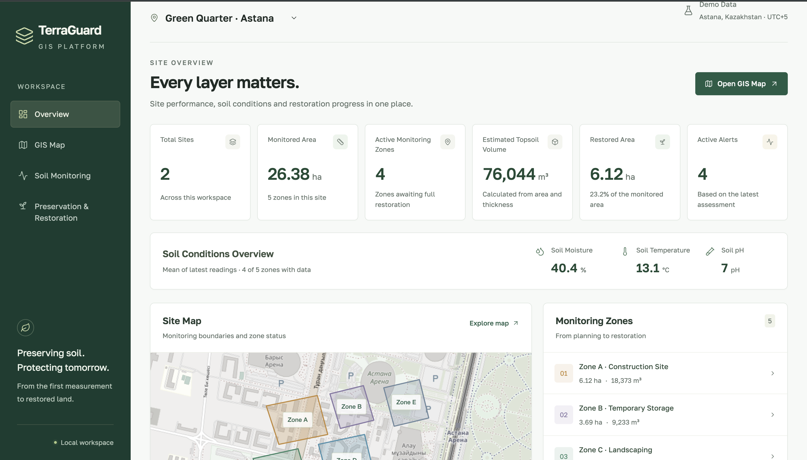
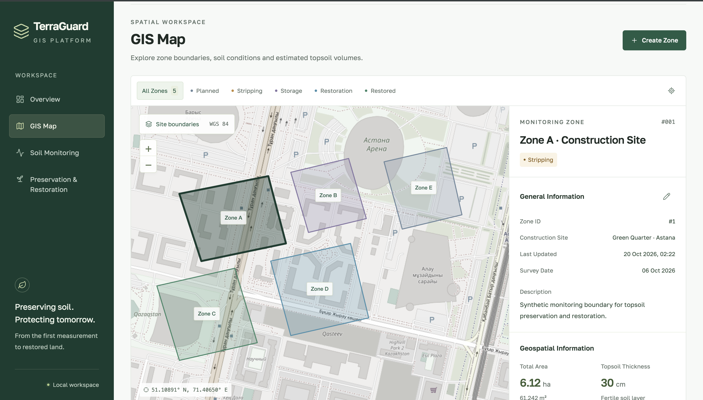

# TerraGuard GIS

**TerraGuard GIS** is a planned web-based geographic information system for monitoring, preserving, and restoring fertile topsoil during construction. The project focuses on tracking soil from its original location through removal, storage, reuse, and follow-up monitoring.

**Diploma project:** Software Engineering, Astana IT University (2026)  
**Current status:** Research, requirements analysis, and system design. **No runnable application has been released yet.**


## Interface Preview (Demo Data)

The following screenshots illustrate the TerraGuard GIS interface using **demo/synthetic data**. They show the intended user experience, but do not demonstrate that all planned functionality or backend integrations are complete.

### Overview Dashboard

The workspace overview brings together site statistics, soil measurements, monitoring zones, alerts, and a map preview.



### GIS Map

The spatial workspace displays zone boundaries and statuses on an interactive-style map, with detailed information for the selected monitoring zone.




## 1. Problem Statement

Construction projects may require topsoil to be removed, stored, and reused. Tracking these operations requires information about the source area, soil quantity, storage location, measurements, and final use. When records are maintained separately in maps, spreadsheets, and documents, reconstructing the history of a soil batch can be difficult.

TerraGuard GIS aims to investigate this challenge and provide a single map-based workflow for maintaining traceable soil records. The extent of the problem and specific user needs will be validated through further research with potential users.

## 2. Target Users!

| Target user | Intended use |
| --- | --- |
| Environmental specialists | Record soil observations, review monitoring history, and prepare documentation. |
| Construction site managers | Track topsoil removal, storage, movement, and reuse. |
| Restoration and landscaping specialists | Record restoration activities and follow-up observations. |
| Soil specialists | Review measurement methods and assess soil-related decision rules. |

These are proposed user groups. Detailed roles and access permissions have not yet been finalized.

## 3. Project Aim and Expected Outcomes

**Aim:** Design, develop, and evaluate a web-based GIS that links spatial soil records with traceable material operations and explainable rule-based decision support.

**Expected outcomes:**

- A working web application prototype with an interactive map.
- A spatial database and API for site, soil batch, and observation records.
- A workflow that traces topsoil from its source through storage and reuse.
- Basic volume estimation, measurement history, and explainable alerts.
- Project documentation, tests, and an evaluation of software correctness and user workflows.

These are planned deliverables, not completed results. Demonstrating environmental improvements would require separate field evidence.

## 4. Team Members and Supervisor

| Team member | Role | Main responsibilities |
| --- | --- | --- |
| **Mazhitova Aknur** | Backend Developer | Database design, API development, input validation, calculation logic, and technical tests. |
| **Zholekesh Kyrmyzy** | Frontend Developer | Interactive maps, forms, charts, interface development, and usability testing. |
| **Tukezhan Kausar** | System Analyst | User research, requirements analysis, literature review, documentation, and evaluation coordination. |

**Supervisor:** Nadirov Nurtas  
**University:** Astana IT University  
**Educational programme:** Software Engineering

Responsibilities describe the planned division of work; documentation, testing, and reviews are shared activities.

## 5. Project Scope

### In Scope (Planned)

The initial prototype is intended to support:

| Functionality | Description | Requirement IDs |
| --- | --- | --- |
| Site mapping | Register site boundaries and sampling locations on a map. | FR-02, FR-03 |
| Soil observations | Enter measurements with units, dates, location, depth, method, and source; validate CSV imports. | FR-04, FR-05 |
| Topsoil traceability | Record removal, storage, movement, and reuse while preserving each soil batch's history. | FR-07, FR-08 |
| Volume estimation | Estimate soil layer volume using area and average thickness with input validation. | FR-09 |
| Monitoring history | Filter observations by location, indicator, and date. | FR-10 |
| Explainable alerts | Apply reviewed, versioned rules and explain why an alert was generated. | FR-11 |
| Restoration records | Connect restoration activities to areas, batches, and follow-up observations. | FR-12 |
| Access control and audit trail | Manage permissions and record changes to project data. | FR-01, FR-14 |
| Laboratory attachments | Associate supporting laboratory files with observations, if feasible. | FR-06 (Should) |
| Data exports | Export permitted records and relevant measurement context, if feasible. | FR-13 (Should) |

The intended core workflow is:

```text
Source area
    -> Topsoil removal
    -> Identifiable soil batch
    -> Storage and observations
    -> Reuse / restoration
    -> Follow-up observations
```

### Out of Scope (Initial Version)

The first version will not include physical soil treatment, sensor manufacturing, automatic control of construction machinery, regulatory certification, mixed-batch modelling, mandatory satellite processing, or machine-learning model training. Live sensor integration is optional and not required for the initial prototype.

The system is intended to support, not replace, qualified environmental assessment.

## 6. Current Development Status

**Stage as of October 2026: research and system design.** Features described in this README are proposed and should not be interpreted as implemented.

| Work area | Current status |
| --- | --- |
| Project proposal and literature review | Draft prepared. |
| Existing-systems comparison and initial user research | Exploratory work documented; further validation needed. |
| Requirements and technology selection | Proposed; awaiting review and finalization. |
| Architecture and interface layouts | Initial designs documented; demo interface screenshots included above. |
| Backend, frontend, and database implementation | Not yet available as runnable code. |
| Automated tests and user evaluation | Planned; results not yet available. |

**Next steps:** Validate requirements with relevant users, agree on the technical baseline, build the first complete source-to-storage-to-reuse workflow, and then implement observation management, alerts, and tests.

## 7. Selected Technologies (Proposed)

| Component | Technology | Purpose |
| --- | --- | --- |
| Backend | **Python + FastAPI** | REST-style API, business logic, and validation. |
| Database | **PostgreSQL + PostGIS** | Relational and geographic data storage and spatial operations. |
| Web mapping | **OpenLayers** | Display and interact with sites and sampling locations. |
| Client-server communication | **JSON API** | Exchange data between the frontend and backend. |
| Decision support | **Versioned, rule-based logic** | Provide traceable alerts based on reviewed rules and measurement context. |

The frontend framework, hosting platform, dependency versions, and map provider are not yet finalized. These technologies represent a proposed baseline rather than a completed setup.

## 8. Project Links and Documentation

- **YouTrack project board:** [TerraGuard GIS — YouTrack](https://242226.youtrack.cloud/agiles/204-1/current)
- **Project documentation:** [TerraGuard GIS academic report](docs/TerraGuard_GIS_Report_v4.docx)

The academic report contains research, initial requirements, architecture, interface sketches, and the evaluation plan. The documentation link requires `docs/TerraGuard_GIS_Report_v4.docx` to be present in the repository.

## 9. Setup, Running, and Testing

> **Not available yet:** This repository is currently in the documentation/design phase. There is no runnable application or verified installation and test commands to provide.

### Setup

No installation is required to read the project documentation. When application code is added, this section will contain the verified prerequisites, dependency installation commands, environment configuration, and PostgreSQL/PostGIS database initialization steps.

### Running the Application

The application cannot be launched at the current stage. Once a working version exists, this section will provide the exact commands to start the database, backend, and frontend and the address where the application can be accessed.

### Testing

Automated tests cannot yet be executed. Once runnable code and tests are available, this section will provide exact test commands and describe the test environment. The planned checks include geometry and volume calculations, CSV validation, material-operation consistency, rule evaluation, access control, and audit history. User workflow evaluation will be documented separately.

## 10. Notes

The prototype will distinguish measured observations from estimates and synthetic test data. Soil-related alerts will require suitable measurement context and reviewed rules; they will not be presented as guaranteed environmental conclusions.

For task assignments and progress updates, refer to the [YouTrack project board](https://242226.youtrack.cloud/agiles/204-1/current).
